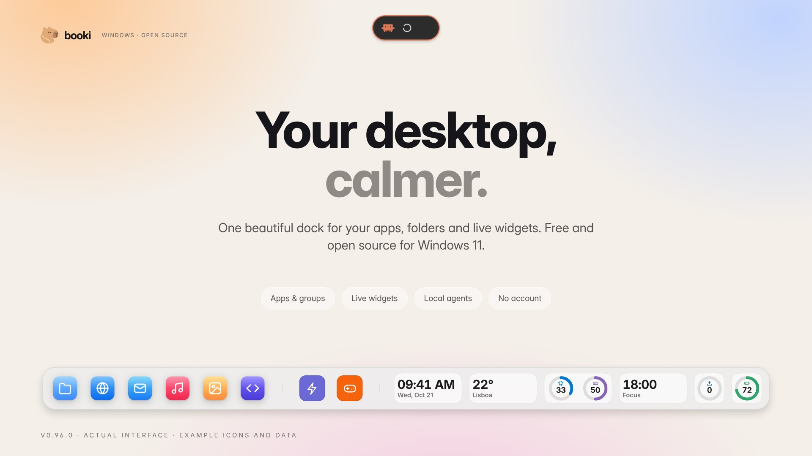
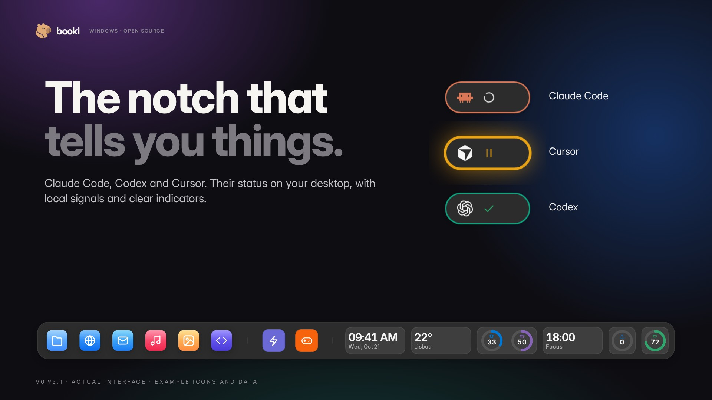
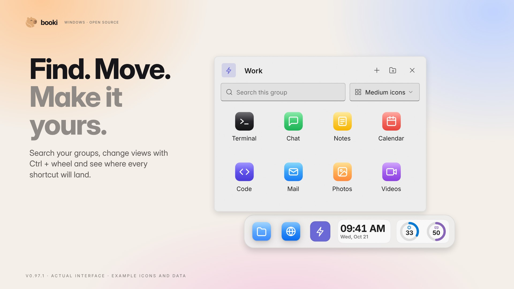
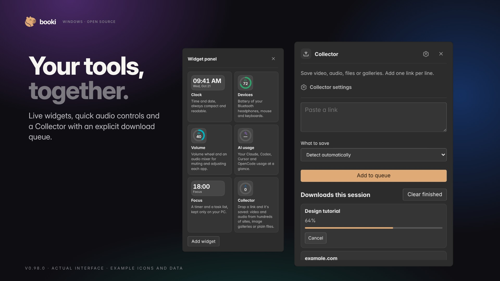
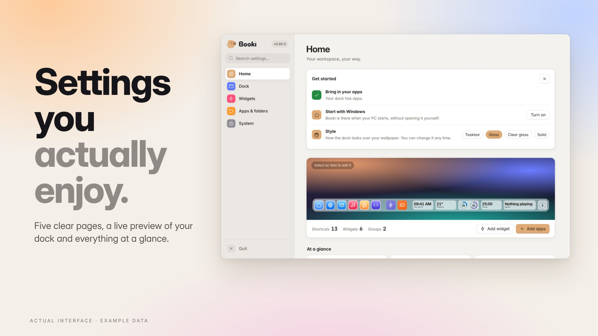
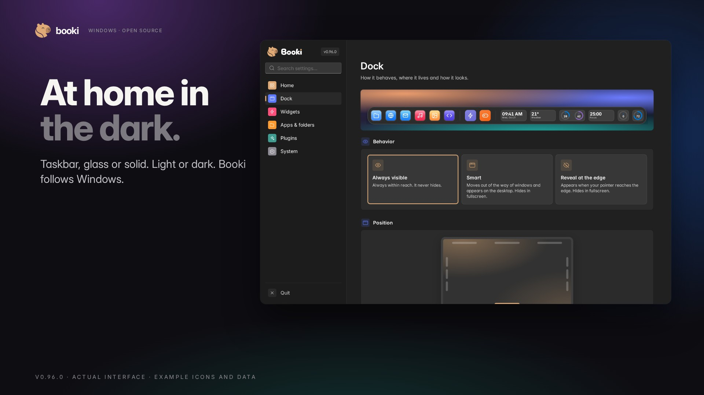

<p align="center">
  
</p>

<h1 align="center">Booki</h1>

<h3 align="center">Your desktop, calmer.</h3>

<p align="center">A beautiful dock for Windows 11 — apps, folders and live widgets in one calm bar.<br/>Free, private and open source.</p>

<p align="center">
  <a href="https://github.com/punkable/booki/releases/latest"><b>Download for Windows</b></a> ·
  <a href="docs/releases/v0.87.0.md"><b>What's new in 0.87</b></a> ·
  <a href="README.es.md">Español</a>
</p>

<p align="center">
  <a href="https://github.com/punkable/booki/releases/latest"></a>
  
  
  <a href="LICENSE"></a>
</p>

<p align="center"></p>

<table align="center">
<tr>
<td align="center" width="25%"><b>⚡ Light</b><br/><sub>Native Rust core. Widgets pause when the dock hides.</sub></td>
<td align="center" width="25%"><b>🔒 Private</b><br/><sub>No accounts, no telemetry, no cloud.</sub></td>
<td align="center" width="25%"><b>🎨 Yours</b><br/><sub>Taskbar, glass, clear or solid. Any edge. Five languages.</sub></td>
<td align="center" width="25%"><b>🧡 Open</b><br/><sub>MIT licensed. Built in the open.</sub></td>
</tr>
</table>

---

<h2 align="center">The notch that tells you things.</h2>

<p align="center">A quiet dot at the top of your screen that opens into a capsule for your focus timer, the song that's playing or a low battery.<br/>Hover it for a card with more. Prefer something simpler? Choose an attached tab or a floating pill.</p>

<p align="center"></p>

<h2 align="center">Groups that look like yours.</h2>

<p align="center">Pin apps, folders, files and websites, then gather them into groups.<br/>Give each group a colour from a curated palette and an icon from the library — it shows in the dock and in Settings.</p>

<p align="center"></p>

<h2 align="center">Live, at a glance.</h2>

<p align="center">Clock, calendar, weather, system (CPU, memory, disk, network), battery, media, volume, notes, clipboard and focus (timer + tasks).<br/>Compact tiles that sit right on the bar.</p>

<p align="center"></p>

<h2 align="center">Settings you actually enjoy.</h2>

<p align="center">Five clear pages — Home, Dock, Widgets, Apps and System — with a live preview of your dock and everything at a glance.</p>

<p align="center"></p>

<h2 align="center">At home in the dark.</h2>

<p align="center">Follows your Windows theme and accent. Match the taskbar, blur what's behind with glass or clear glass, or stay solid.<br/>When a game or video goes fullscreen, Booki steps aside.</p>

<p align="center"></p>

---

<h2 align="center">Private by design.</h2>

<p align="center">No accounts. No telemetry. No cloud sync. Your tasks, notes and usage stay on your PC.<br/>Weather asks only for the city you choose — never your location.</p>

<p align="center"><sub>Images show the actual Booki 0.86 interface with example data and generic sample icons.</sub></p>

## Get started

1. Open [Releases](https://github.com/punkable/booki/releases/latest) and pick `Booki_*_x64-setup.exe` (Intel/AMD) or `Booki_*_arm64-setup.exe` (Windows on ARM). An x64 MSI is also available.
2. Launch **Booki** from the Start menu. The installer is per-user and fetches WebView2 if it's missing.
3. Drag an app or folder onto the dock, or right-click the dock to add items.

Booki needs Windows 10 or 11. The installer isn't Authenticode-signed yet, so SmartScreen may warn you. Updates are signature-checked and keep your settings. The new background updater applies to the registered per-user setup installation; MSI/portable copies should use the same installer type from Releases.

### New in 0.87

- A shared catalog for HeadsetControl, yt-dlp, OpenRGB, Rclone and LibreHardwareMonitor, plus checks through the winget managed by Windows App Installer.
- Widget detail panels and a native Windows volume mixer for individual apps.
- Layered light/dark WinUI neutrals and a continuous dynamic-notch/dock spring transition in both directions.

See the [0.87 release notes](docs/releases/v0.87.0.md) for setup requirements and validation limits.

### New in 0.86

- **Feels like Windows 11** — WinUI-style menus, Windows' accent colours, 4/8 px corners, Windows type sizes and motion steps, taskbar-style hints and thin scrollbars.
- **A live notch widens into the dock** from wherever it sits, with one spring for the whole move, and the dock no longer blinks behind the active app.
- **Devices widget** — battery of Bluetooth headphones, mice and keyboards, Logitech devices on a Bolt or Unifying receiver, and wireless headsets through the optional HeadsetControl plugin.
- **AI usage widget (opt-in)** — your Claude and ChatGPT/Codex limits, read from the sign-in those apps already keep on your PC.
- **Plugins** — optional open-source tools you install from Settings, verified before they run.
- **Smarter start with Windows** — the dock appears at once while Booki stays out of the way during sign-in.
- **A first dock that already looks like yours**, a simpler Dock page with More settings, a "Charging" moment on the notch, and many fixes.

### New in 0.85

- **Four dock styles you can tell apart** — Taskbar, Glass, Clear glass and Solid, each previewed as it really looks in Settings and switchable from the dock's right-click menu.
- **Dock fill and accent are separate** — the fill can follow the wallpaper, the accent or a color you pick; the Taskbar style matches your Windows taskbar.
- **Real blurred glass** on Windows 11, clipped to the dock's rounded shape, with no sheen or inner rectangle.
- **A fuller right-click menu** on the dock and the notch, and a notch that no longer stays cut in half.

### New in 0.84.1

- **The theme you pick is the one you get**, without light and dark pieces mixed in the dock and its menus.
- **An even notch dot**, drawn whole at rest.
- **The dock grows out of the notch** when something is playing or a timer is running.

### New in 0.84

- **Keyboard and clicks like the taskbar** — arrow keys move along the dock; Shift+click opens another window and Ctrl+Shift+click runs as administrator.
- **More at home in Windows** — native notifications, each app's recent files in its menu, high contrast, and apps asking for attention marked in the dock.
- **The dock wears the taskbar's color** in every finish, and groups open in place in Settings.
- **Many fixes** found in a full review of the dock, Settings and the native core.

### New in 0.83

- **Colors like Windows** — follow the Windows accent and taskbar, or tint the dock with your wallpaper.
- **A suggested palette** — Pantone Colors of the Year that suit Booki, with any other color one click away.
- **Group dragging in Settings works on Windows**, and resting on a group opens it to drop between its members.

### New in 0.82

- **Open apps, not new copies** — clicking an open app goes to its window; clicking the one in front minimizes it.
- **Quick launcher** — Ctrl+Alt+Space searches apps, folders and open windows.
- **A notch that steps aside** — it hides over maximized apps and comes back when you reach for it.
- **Easier groups** — drop an app across the middle of another, and drag apps in and out of groups in Settings.
- **Weather forecast and new panels**, plus automatic profiles by monitor or schedule.

See the [0.86 release notes](docs/releases/v0.86.0.md), the [0.85 release notes](docs/releases/v0.85.0.md), the [0.84.1 fixes](docs/releases/v0.84.1.md), the [complete 0.84 release notes](docs/releases/v0.84.0.md), [0.83](docs/releases/v0.83.0.md), [0.82](docs/releases/v0.82.0.md), [0.81](docs/releases/v0.81.0.md) and the [0.80 overhaul](docs/releases/v0.80.0.md).

## Everyday controls

| Action | Result |
|---|---|
| Click a pin | Launch it or focus its window |
| Drag desktop → dock | Pin an app, folder, file or image; ordinary pinning preserves the original |
| Drag a pin out | Unpin, or return a shortcut to the desktop |
| Right-click the dock | Add items, choose a profile or open Settings |
| Middle-click a pin | Reveal its location in Explorer |
| Double-click a widget | Open its configuration; utility widgets open their own panel |
| `Alt` + `1…9` | Launch the corresponding pin; the modifier is configurable |
| Push the cursor to the edge | Reveal a hidden dock when edge/hover behavior is enabled |
| Wheel over Media, if enabled | Change system volume |
| Hover a widget | Its hint lists the details (every device's battery, every AI usage window and when it resets) |

## Privacy and your data

- No telemetry, accounts or cloud synchronization. Configuration lives at `%APPDATA%\Booki\config.json`, with a safety backup.
- Network requests are limited to update checks/downloads and website favicons, plus three things that happen only when you turn them on: Open-Meteo weather after choosing a city (never your device location), plugin downloads from their official GitHub releases (checked against GitHub's SHA-256 digest), and the AI usage widget.
- The AI usage widget reads the sign-in Claude Code (`~/.claude`) and Codex (`~/.codex`) already keep on your PC and sends each only to its own service (Anthropic or OpenAI) to read your plan's usage. Booki never stores, logs or forwards it, and asks only while the widget is on the dock.
- Device batteries come from Windows itself, from Logitech receivers over USB, and, if you installed it, from HeadsetControl running on your PC. Nothing leaves your computer.
- Plugins live in `%LOCALAPPDATA%\Booki\plugins`; removing one in Settings deletes its folder.
- App recommendations read Windows' local usage record and local successful Booki launches (`app-usage.json`). Usage is not uploaded.
- Clipboard history is local. Restart persistence is off by default; when enabled, it is protected for your Windows user and can expire.
- Compatible captures hide the dock by default. Enable **Visible in captures** in Settings when recording it.
- Uninstall preserves settings unless you select **Delete app data**. Normal uninstall removes the startup entry and Explorer shell actions.

## Support

Booki is free and open source (MIT), by **[Punkable](https://github.com/punkable)** ([@0xPunki](https://x.com/0xPunki)).

Donations are optional:

| | Network | Address |
|---|---------|---------|
|  | **Bitcoin** | `bc1pltth9wcqnctc2nqa6he6puqpqs83a2rdkxhyk8gk53uvk6v2mnustsq7t3` |
|  | **Solana** | `JCRkiVEm5sPBNnna1j16CRu5E4VeNWtoj6TThxmVFB4W` |

Questions or bugs: **[punkable@protonmail.com](mailto:punkable@protonmail.com)** or open an issue. See [SECURITY.md](SECURITY.md) for vulnerabilities.

## Development

Booki uses Tauri 2, Rust/Win32, a vanilla JavaScript dock and React settings, built with Vite. Linux/macOS can preview the frontend with sample data; native behavior requires Windows and WebView2.

```bash
npm ci
npm run dev          # browser preview at http://localhost:1420
npm run check:all    # contracts, build and functional tests
npm run tauri:dev    # native app on Windows with Rust installed
npm run tauri:build  # Windows packages
```

UI changes follow the [visual identity and design system](docs/brand/README.md).

The images and film are rebuilt from the real frontend by [tools/presentation](tools/presentation/README.md); finished media live in `docs/presentation/`. Older native Windows captures and PNG brand exports are kept in `docs/`.

To audit the current public release without running its installers:

```bash
node scripts/audit-release.mjs /absolute/path/to/release-audit
```

This downloads the public assets, checks GitHub hashes, verifies updater signatures using Booki's configured public key, and validates the manifest and installer containers. It does not verify Windows runtime behavior or Authenticode.

Releases are built from version tags through [release.yml](.github/workflows/release.yml). Publishing requires the complete signed updater asset set and matching versions. The workflow uploads and re-downloads the draft assets for integrity checks before publication, preserving older releases for rollback.

## License and credits

[MIT](LICENSE). Booki by [Punkable](https://github.com/punkable) · [@0xPunki](https://x.com/0xPunki).

Emoji artwork: [Fluent Emoji](https://github.com/microsoft/fluentui-emoji) © Microsoft, MIT. AI provider logos: [LobeHub Icons](https://github.com/lobehub/lobe-icons) (MIT); the marks belong to their owners. Device glyphs: [Lucide](https://lucide.dev/) (ISC). Optional city weather: [Open-Meteo](https://open-meteo.com/). The presentation uses the official Booki logo, [Inter](tools/presentation/fonts/OFL.txt) under the SIL Open Font License, and no third-party music. See the [visual identity guidelines](docs/brand/README.md).

### Quality and design

See the [CoolDock research and design decisions](docs/research/cooldock.md) and [premium workspace implementation, measurements and verification limits](docs/quality/premium-workspace.md).
