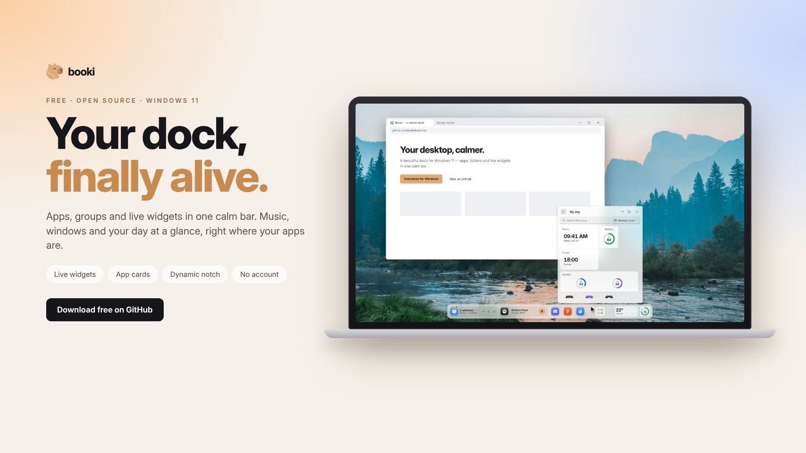
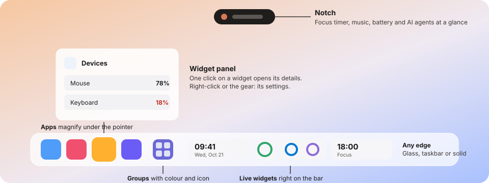
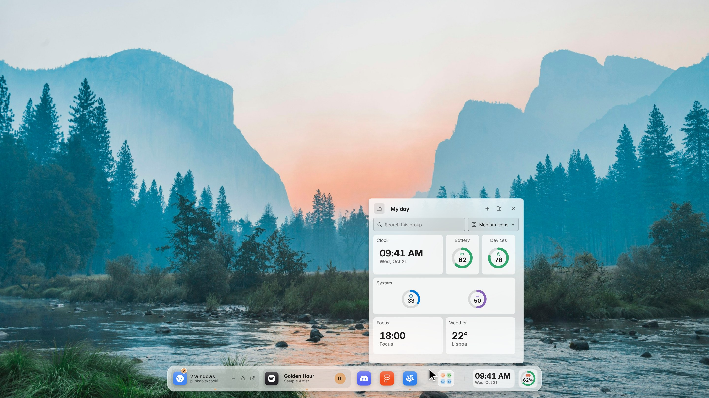
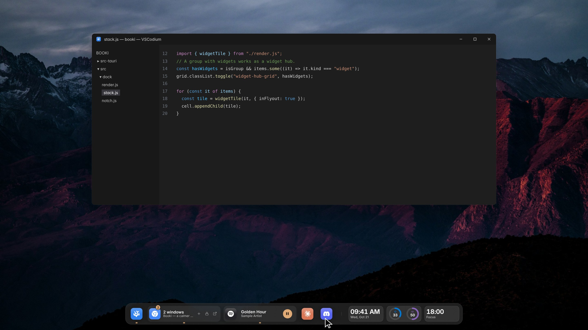
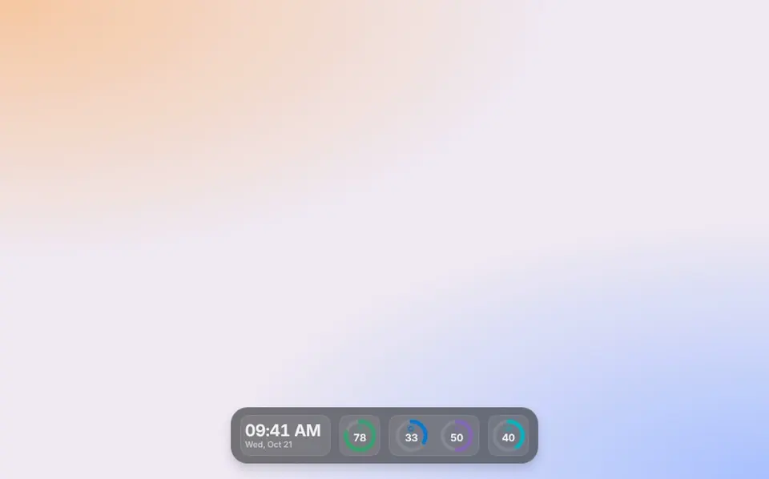
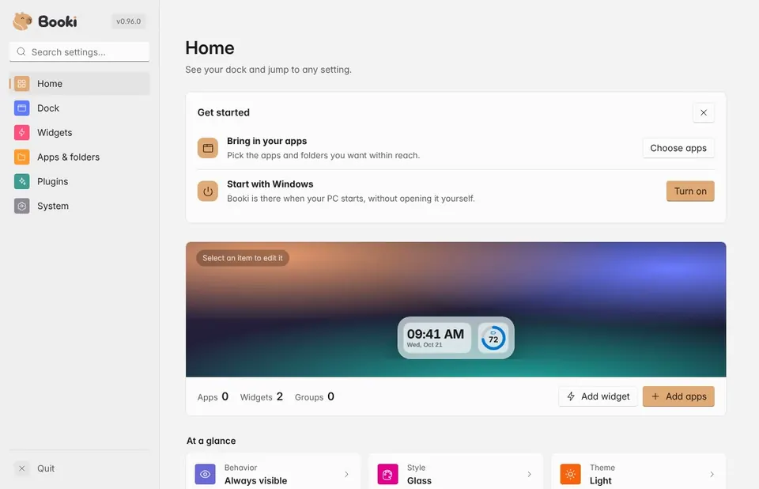
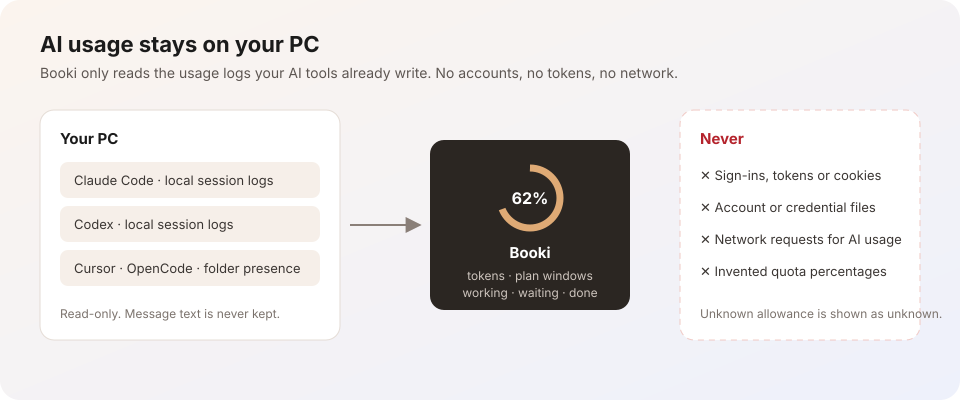

<p align="center">
  
</p>

<h1 align="center">Booki</h1>

<h3 align="center">Your dock, finally alive.</h3>

<p align="center">A beautiful dock for Windows 11. Your apps, groups and live widgets in one calm bar:<br/>the song that's playing, your open windows and your day, right where your apps are.<br/>Free, private and open source.</p>

<!-- booki:download:start -->
<p align="center">
  <a href="https://github.com/punkable/booki/releases/download/v1.0.0/Booki_1.0.0_x64-setup.exe"><b>Download for Windows v1.0.0 (x64)</b></a> ·
  <a href="https://github.com/punkable/booki/releases/download/v1.0.0/Booki_1.0.0_arm64-setup.exe">ARM64</a> ·
  <a href="https://github.com/punkable/booki/releases/download/v1.0.0/Booki_1.0.0_x64_en-US.msi">MSI x64</a> ·
  <a href="docs/releases/v1.0.0.md">What's new v1.0.0</a>
</p>
<!-- booki:download:end -->

<p align="center">
  <a href="https://github.com/punkable/booki/releases/latest"></a>
  
  
  <a href="LICENSE"></a>
</p>

<p align="center"></p>

<table align="center">
<tr>
<td align="center" width="25%"><b>⚡ Light</b><br/><sub>Native Rust core. Widgets pause when the dock hides.</sub></td>
<td align="center" width="25%"><b>🔒 Private</b><br/><sub>No accounts, no telemetry, no cloud.</sub></td>
<td align="center" width="25%"><b>🪟 Native</b><br/><sub>Windows 11 acrylic, light and dark. Any edge.</sub></td>
<td align="center" width="25%"><b>🧡 Open</b><br/><sub>MIT licensed. Built in the open.</sub></td>
</tr>
</table>

<p align="center"></p>

---

<h2 align="center">Groups that work like a widget board.</h2>

<p align="center">Put widgets and apps in the same group and it opens like the Windows Widgets board:<br/>live cards in three sizes, apps beside them, in whatever order you drag them.</p>

<p align="center"></p>

<h2 align="center">Apps that show what they're doing.</h2>

<p align="center">Turn a pinned app into a live card: your music player shows the song and its controls,<br/>your browser how many windows are open with a button for a new or private one.</p>

<p align="center"></p>

<h2 align="center">Smooth at any refresh rate.</h2>

<p align="center">Icons grow under your pointer with time-based motion: just as quick at 60, 144 or 240 Hz, only smoother on faster screens, with no overshoot.<br/>Pick glass (Windows 11 acrylic, light or dark), the taskbar's own look, or solid.</p>

<p align="center"></p>

<p align="center"></p>

<h2 align="center">Widgets that open with one click.</h2>

<p align="center">Clock, calendar, weather, system, battery, devices, AI usage, media, volume, notes, clipboard, focus, Collector, updates and lighting.<br/>One click opens a widget's details; right-click or its gear opens its settings.</p>

<p align="center"></p>

<p align="center"></p>

<h2 align="center">A gallery to make them yours.</h2>

<p align="center">The widgets on your dock sit at the top. Below, explore by category and add one in a click.<br/>Its settings open beside the gallery with a live preview: content, look and colour.</p>

<p align="center"></p>

<p align="center"></p>

<h2 align="center">The notch that tells you things.</h2>

<p align="center">A quiet capsule at the top of your screen for your focus timer, the song that's playing, a low battery,<br/>or your AI coding agents: working, waiting for you, done.</p>

<p align="center"></p>

<p align="center"></p>

<h2 align="center">Groups that look like yours.</h2>

<p align="center">Pin apps, folders, files and websites, then gather them into groups with a colour and an icon.<br/>Search inside a group and switch between list and icon sizes with Ctrl + wheel.</p>

<p align="center"></p>

<h2 align="center">At home in the dark.</h2>

<p align="center">Follows your Windows theme and accent. When a game or video goes fullscreen, Booki steps aside.</p>

<p align="center"></p>

---

<h2 align="center">Private by design.</h2>

<p align="center">No accounts. No telemetry. No cloud sync. Your tasks, notes and usage stay on your PC.<br/>Weather asks only for the city you choose — never your location.</p>

<p align="center"></p>

<!-- booki:media:start -->
<p align="center"><sub>Source frontend captures for v1.0.0, with example data. Native Windows blur requires an in-app check.</sub></p>
<!-- booki:media:end -->

<!-- booki:news:start -->
## What's new in 1.0.0

Booki 1.0: your dock, finally alive. Groups that work as a widget board, apps that show what they're doing and a dynamic notch in every mode.

- A group with widgets opens like the Windows Widgets board: small, medium or wide cards (right-click), mixed with apps in the order you drag them, with the rest gliding aside as you move one.
- Show a pinned app as a live card (right-click › Show as widget): your player with the song and its controls, your browser with its windows and new or private window buttons.
- New Wi‑Fi, Bluetooth and Windows Settings widgets, and a notice when headphones or another device connect or disconnect.
- Behaviour rebuilt with illustrated cards: when it hides, how it comes back and what stays while hidden, without one option silently changing others. Pointing at the notch waits 0.3 s (adjustable).
- The dynamic notch (music, timer, battery, volume, agents) now also works with “point at the notch”, you choose what it shows, and over a maximized app it still shows what's urgent.
- Exceptions: hide in fullscreen and apps the dock always steps aside for.
- A new About tab with what's new, help, links and support; System keeps the settings.
- No double border when hovering widgets and groups, rings with icon and number kept apart and lighter catalog buttons.
- If Windows' media service stalls, widgets no longer freeze: every query has a time limit and the buttons never wait behind it.
- Fixes: the player card no longer controls another app's music, the exception list applies at once, an open group no longer shows a ghost label behind it and grouped widgets keep their layout with the dock on a side edge.

[Full release notes](docs/releases/v1.0.0.md)
<!-- booki:news:end -->

## Get started

1. Open [Releases](https://github.com/punkable/booki/releases/latest) and pick `Booki_*_x64-setup.exe` (Intel/AMD) or `Booki_*_arm64-setup.exe` (Windows on ARM). An x64 MSI is also available.
2. Launch **Booki** from the Start menu. The installer is per-user and fetches WebView2 if it's missing.
3. Drag an app or folder onto the dock, or right-click the dock to add items.

Booki needs Windows 10 or 11. The installer isn't Authenticode-signed yet, so SmartScreen may warn you. Updates are signature-checked and keep your settings. The new background updater applies to the registered per-user setup installation; MSI/portable copies should use the same installer type from Releases.

<!-- booki:history:start -->
## Recent updates

| Version | What changed |
|---|---|
| [0.98.0](docs/releases/v0.98.0.md) | Clearer Settings, like Windows 11: each widget and dock item gets its own page, colours use Booki's palette, and the dock no longer blocks clicks on half the screen. |
| [0.97.0](docs/releases/v0.97.0.md) | Booki now understands your AI agents better: Claude's real plan usage and exact states for Claude Code, Codex, Gemini CLI and Cursor, plus flicker-free glass and Windows 11 controls. |
| [0.96.0](docs/releases/v0.96.0.md) | Windows 11 acrylic glass for each theme, a new widget gallery, smooth motion at any refresh rate and plugin updates. |

[All published releases](https://github.com/punkable/booki/releases)
<!-- booki:history:end -->

## Everyday controls

| Action | Result |
|---|---|
| Click a pin | Launch it or focus its window |
| Drag desktop → dock | Pin an app, folder, file or image; ordinary pinning preserves the original |
| Drag a pin out | Unpin, or return a shortcut to the desktop |
| Right-click the dock | Add items, choose a profile or open Settings |
| Middle-click a pin | Reveal its location in Explorer |
| Click a widget | Open its details or controls |
| Right-click a widget, or its gear | Open the settings of that copy |
| Right-click a group → Customize | Edit name, icon and color; expand a picker only when needed, then Apply or Cancel |
| `Ctrl` + wheel inside a group | Switch between list and icon sizes |
| Drag from a group | See the shortcut and destination; `Escape` cancels |
| `Alt` + `1…9` | Launch the corresponding pin; the modifier is configurable |
| Push the cursor to the edge | Reveal a hidden dock when edge/hover behavior is enabled |
| Wheel over Media, if enabled | Change system volume |
| Hover a widget | Its hint lists the details (every device's battery, every AI usage window and when it resets) |

Collector supports video, audio, files and galleries: paste one link per line to queue several. Its gear opens folder, format and quality preferences, also available in Widgets and Plugins. The queue and results last until Booki closes.

## Privacy and your data

- No telemetry, accounts or cloud synchronization. Configuration lives at `%APPDATA%\Booki\config.json`, with a safety backup.
- Network requests are limited to update checks/downloads and website favicons, plus features you explicitly enable: Open-Meteo weather after choosing a city (never your device location), plugin downloads from their official release pages (each checked against a SHA-256 checksum pinned in Booki's source). The AI usage widget makes no network requests.
- The AI usage widget only reads, read-only, the local session logs of Claude Code (`~/.claude/projects`) and Codex (`~/.codex/sessions` and `archived_sessions`, or `CODEX_HOME`). For Cursor and OpenCode it only checks that their folders exist. Booki never reads, uses, stores or sends sign-ins, tokens or credential files, keeps no message content and makes no network request for it. Claude's logs hold no plan limits, so the widget shows tokens used; Codex's logs include its plan percentages; a missing allowance is shown as unknown, never estimated.
- Optional, off by default: **Real Claude plan usage** lets Claude Code pass its 5-hour and 7-day percentages to Booki through its status line (your own status line keeps running), and **Exact agent states** adds a Booki hook to Claude Code, Codex, Gemini CLI or Cursor so the notch knows when an agent is working, waiting for permission or done. Booki only writes those percentages and event kinds to `%LOCALAPPDATA%\Booki\agents`, backs up each agent's config once and removes only its own entries when you turn it off. No credentials, no network.
- Device batteries come from Windows itself, from Logitech receivers over USB, and, if you installed it, from HeadsetControl running on your PC. Nothing leaves your computer.
- Plugins live in `%LOCALAPPDATA%\Booki\plugins`; removing one in Settings deletes its folder. Booki tells you when a newer pinned version is available, and updating keeps your widgets as they are. They are independent third-party tools under their own licenses, installed only when you choose to; you are responsible for using them lawfully. See the [terms of use](TERMS.md).
- App recommendations read Windows' local usage record and local successful Booki launches (`app-usage.json`). Usage is not uploaded.
- Clipboard history is local. Restart persistence is off by default; when enabled, it is protected for your Windows user and can expire.
- Compatible captures hide the dock by default. Enable **Visible in captures** in Settings when recording it.
- Uninstall preserves settings unless you select **Delete app data**. Normal uninstall removes the startup entry and Explorer shell actions.

## Support

Booki is free and open source (MIT), by **[Punkable](https://github.com/punkable)** ([@0xPunki](https://x.com/0xPunki)).

Donations are optional:

| | Network | Address |
|---|---------|---------|
|  | **Bitcoin** | `bc1pltth9wcqnctc2nqa6he6puqpqs83a2rdkxhyk8gk53uvk6v2mnustsq7t3` |
|  | **Solana** | `JCRkiVEm5sPBNnna1j16CRu5E4VeNWtoj6TThxmVFB4W` |

Questions or bugs: **[punkable@protonmail.com](mailto:punkable@protonmail.com)** or open an issue. See [SECURITY.md](SECURITY.md) for vulnerabilities.

## Development

Booki uses Tauri 2, Rust/Win32, a vanilla JavaScript dock and React settings, built with Vite. Linux/macOS can preview the frontend with sample data; native behavior requires Windows and WebView2.

```bash
npm ci
npm run dev          # browser preview at http://localhost:1420
npm run check:all    # contracts, build and functional tests
npm run tauri:dev    # native app on Windows with Rust installed
npm run tauri:build  # Windows packages
```

UI changes follow the [visual identity and design system](docs/brand/README.md).

README images and clips are recorded from the real frontend with sample data by [tools/presentation](tools/presentation/README.md) (`stills.mjs`, `clips.mjs`, `desktop.mjs`); finished media live in `docs/presentation/`. Desktop wallpapers are photos from [Unsplash](https://unsplash.com) (Unsplash License); app marks come from [Simple Icons](https://simpleicons.org) and belong to their owners. They illustrate apps Booki can pin and do not imply endorsement.

To audit the current public release without running its installers:

```bash
node scripts/audit-release.mjs /absolute/path/to/release-audit
```

This downloads the public assets, checks GitHub hashes, verifies updater signatures using Booki's configured public key, and validates the manifest and installer containers. It does not verify Windows runtime behavior or Authenticode.

Releases are built from version tags through [release.yml](.github/workflows/release.yml). Publishing requires the complete signed updater asset set and matching versions. The workflow uploads and re-downloads the draft assets for integrity checks before publication, preserving older releases for rollback.

## License and credits

[MIT](LICENSE) · [Terms of use and plugin notice](TERMS.md). Booki by [Punkable](https://github.com/punkable) · [@0xPunki](https://x.com/0xPunki).

Emoji artwork: [Fluent Emoji](https://github.com/microsoft/fluentui-emoji) © Microsoft, MIT. AI provider logos: [LobeHub Icons](https://github.com/lobehub/lobe-icons) (MIT); the marks belong to their owners. Device glyphs: [Lucide](https://lucide.dev/) (ISC). Optional city weather: [Open-Meteo](https://open-meteo.com/). The presentation uses the official Booki logo, [Inter](tools/presentation/fonts/OFL.txt) under the SIL Open Font License, and no third-party music. See the [visual identity guidelines](docs/brand/README.md).
